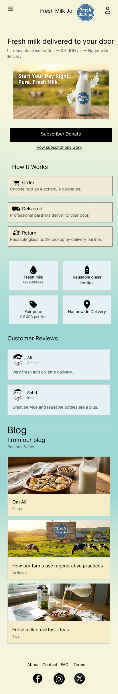
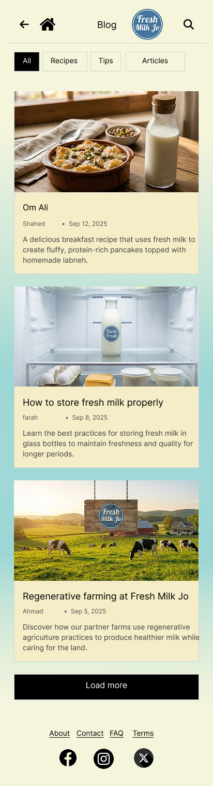
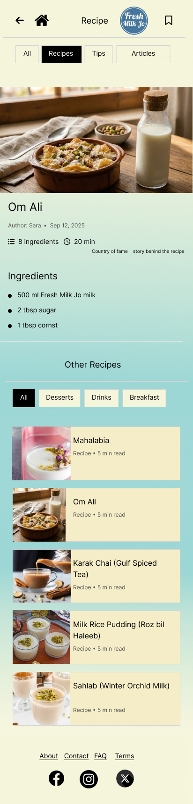

# 🥛 Fresh Milk Jo – UI/UX Website Design

A complete UI/UX website design for **Fresh Milk Jo**, a fresh milk delivery brand. Designed entirely in Figma, featuring a modern homepage, blog, recipe pages, and a clean, user-friendly interface focused on freshness, simplicity, and a natural brand identity.

## 📌 Project Overview

Fresh Milk Jo is a website design concept for a milk delivery brand that aims to make fresh milk accessible while promoting a healthy and sustainable lifestyle.

The design focuses on creating a welcoming digital experience that communicates the brand's identity, presents its services, and provides engaging content for visitors.

This project was created entirely in **Figma** as a UI/UX design project.

## 🎯 Design Goals

- Create a clean and modern website interface.
- Establish a recognizable and natural brand identity.
- Present milk products and delivery services clearly.
- Make website navigation simple and intuitive.
- Provide an engaging experience through recipes, tips, and articles.
- Maintain visual consistency across all pages.

## 🎨 Design Highlights

### 1. Homepage
- Fresh Milk Jo branding and hero section.
- Subscription and donation calls to action.
- Three-step ordering and delivery process.
- Product benefits and customer testimonials.
- Blog and recipe previews.

### 2. Blog Page
- Blog categories: All, Recipes, Tips, and Articles.
- Article cards with images and publication information.
- Organized content layout.
- Load More button.

### 3. Recipe Details Page
- Recipe information and featured images.
- Ingredients and preparation details.
- Author and preparation time.
- Related recipes and category navigation.

## 🖼️ Screenshots

Add your exported Figma screenshots to the `screenshots` folder using these filenames:

### Homepage


### Blog Page


### Recipe Details


## 🛠️ Tools & Technologies

- **Figma** – UI design and prototyping
- **UI Design** – Layout, typography, colors, and components
- **UX Design** – User experience and navigation
- **Visual Branding** – Brand identity and visual consistency

## 🎨 Design Approach

The visual direction uses a fresh and natural aesthetic to reflect the brand's connection to milk, health, and sustainability.

Key design considerations include:

- Soft and welcoming colors.
- Clear typography and visual hierarchy.
- Consistent spacing and alignment.
- User-friendly navigation.
- Consistent components across website pages.

## 🔗 Figma Design

[View the Fresh Milk Jo Design on Figma](https://www.figma.com/design/pRVMZ0K5Dfd6OQRcDkL3DB/Assignment2_part2_amr-alramahi-169819?node-id=0-1&t=50aZ0r5WaztB79pK-1)

## 📂 Project Structure

```text
Fresh-Milk-Jo-UI-UX/
│
├── README.md
│
├── screenshots/
│   ├── homepage.png
│   ├── blog.png
│   └── recipe-page.png
│
└── design/
    └── project-preview.pdf
```

## 👨‍💻 Author

**Amr Alramahi**

UI/UX Design Project – Fresh Milk Jo

---

⭐ If you like this design, feel free to explore the project on Figma!
